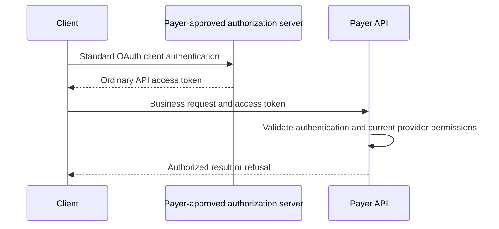

HAP-1 HTTP requests use standard API authentication and payer-side authorization.
The payer resolves the client's verified provider relationships and permissions from trusted records.
HAP defines no separate access credential, token format, or credential issuance exchange.

**Draft version:** `1.0-draft.5`, shared with the [identity walkthrough](hap-1.md) and [voice profile](hap-1-voice.md).
This is a proposal for partner review. Reference software and independent interoperability checks remain open.

## Use standard API authentication

The initial HTTP example uses ordinary OAuth 2.0 client credentials and a bearer access token over HTTPS.

| Area | Standard |
| --- | --- |
| Client authentication and access tokens | [OAuth 2.0 client credentials](https://www.rfc-editor.org/rfc/rfc6749.html#section-4.4) |
| Access token presentation | [OAuth bearer tokens](https://www.rfc-editor.org/rfc/rfc6750.html#section-2.1) |
| Server-side token status and authorization context | [OAuth token introspection](https://www.rfc-editor.org/rfc/rfc7662.html) |

The payer selects its accepted authentication method and trusted authorization server.
That server maintains a verified association between the client and its organization.
Clients follow the published authentication requirements.

Access tokens can be opaque references to server-side state.
If the payer uses structured tokens, its standard authentication system validates them under its configured trust policy.
HAP adds no custom token claims, signing algorithm, provider-access token object, or second grant exchange.

A payer can require standard sender constraints, such as [DPoP](https://www.rfc-editor.org/rfc/rfc9449.html), through its advertised security policy.
Clients must follow that policy without silently falling back to a weaker method.
Such a policy does not introduce a separate HAP credential.

## Discover the payer's requirements

The client MUST get its authentication and access requirements from authenticated payer-controlled discovery information.
That information can come from a configured payer profile or a payer-published Agent Card.
A service's own advertisement does not establish payer approval.
The client needs an authenticated payer-to-domain or payer-to-card mapping before trusting an advertised endpoint.

The payer publishes:

| Requirement | Contents |
| --- | --- |
| Version and API | Accepted HAP versions and the intended payer API |
| Authentication | Accepted security scheme, trusted authorization server, token endpoint, and client setup requirements |
| Permissions | Supported operations, required scopes, provider delegation evidence, and record limits |
| Authorization sources | Services, if any, trusted to establish provider delegation or permissions |
| Policy validity | Cache lifetime or another explicit refresh rule |

The [claim-status Agent Card](https://raw.githubusercontent.com/Healthcare-Agent-Protocol/healthcare-agent-protocol/main/examples/claims/1.0-draft.2/a2a.agent-card.json) declares OAuth through standard A2A security fields.
The discovery serialization for other integrations remains open.
Public discovery information MUST contain no patient data, credentials, tokens, or delegation evidence.

The [voice profile](hap-1-voice.md#discover-where-to-register) adds destination coverage, registration endpoints, and call-reference methods.
A phone-call reference does not authenticate an HTTP request.

## Authenticate the client

For the OAuth example, the client gets an ordinary access token from the advertised token endpoint.
It uses the authorization server's accepted client authentication and requests the `claim.status.read` scope.
OAuth handles the token request, response, expiry, and authentication errors.

The client does not add HAP-specific version, provider constraints, or delegation evidence to the OAuth token request.
The Agent Card advertises the HAP identity version separately from the business operation version.
The payer establishes provider authority through its approved enrollment and authorization workflow.

Client authentication identifies the organization and client making the request.
A token with the right scope does not, by itself, establish permission to read a particular provider's claims.

## Send an authenticated request

The client sends its ordinary API access token in the HTTP authorization header:

```http
POST /a2a HTTP/1.1
Host: payer.example
Authorization: Bearer <api-access-token>
Content-Type: application/json
```

The [claim-status contract](../claims/claim-status.md#a2a-discovery-and-messages) supplies the A2A version and extension headers and the business request body.
This example illustrates authentication; it does not define another business endpoint.
Tokens do not belong in discovery metadata, URLs, task identifiers, or business request fields.



The payer can use its own server-side token state or an authenticated introspection service to validate an opaque token.
The client does not need to read the token's contents.

## Resolve authorization on the server

The payer resolves the authenticated client, organization, verified provider relationships, permitted actions, and record constraints from trusted records.
Those records can live with the payer or an authorization service approved for that purpose.
A service approved only to establish identity cannot establish provider delegation or permissions.

The payer MUST check the following before each protected operation:

1. The API authentication is valid for the intended payer API under its configured security policy.
2. The requested action is covered by the client's current permissions and required scope.
3. The client has current, verified authority to act for the requested provider.
4. The requested record satisfies that provider relationship and any narrower access limits.
5. No applicable client, provider, service, or operation block prevents access.

For the first pilot, the stored claim's billing-provider NPI must match a provider for which the client has verified authority.
An NPI supplied in the request does not establish delegation or override the stored claim relationship.
A rendering, referring, or unrelated provider relationship does not satisfy this rule.
Other record relationships require an agreed, versioned extension.

Knowledge of patient identifiers or claim facts alone MUST NOT establish provider-to-agent authority.
Missing, expired, revoked, or unverifiable authority MUST NOT permit protected work.

The payer returns authentication and authorization failures through the selected HTTP security scheme, including HTTP 401 or 403 where applicable.
Failures disclose no protected record details and do not become a claim denial or a request for business matching information.
Task retrieval, continuations, and follow-up messages repeat current authorization checks.

## Expiry, revocation, and retries

API tokens follow the selected authentication system's validity and revocation rules.
Provider delegation and operation permissions have their own current validity checks.
An unexpired token does not override withdrawn delegation or local payer blocks.

The integration sets freshness limits for authorization information and defines how revocations reach the payer.
If required status information is unavailable or too old, the payer rejects or defers protected work.
Short token lifetimes alone do not establish immediate revocation.

Getting a replacement API token does not expand provider authority.
Business retries and idempotency follow their operation contract.
A cached result, valid task ID, or verified phone call does not bypass current HTTP authorization.

## Data boundaries

Patient identifiers, claim identifiers, business payloads, and protected results pass directly between the client and payer.
External authentication, introspection, and authorization services receive only the identity and access metadata needed for their approved role.
Provider delegation evidence sent outside the payer excludes patient and claim details.
Status checks contain no business request bodies or claim content.

Operational logs omit credentials, tokens, protected payloads, and delegation evidence.
Components handling business requests run within the payer's protected environment.

[Payload encryption](hap-1.md#optional-payload-encryption) is optional and needs a separately agreed profile.
It does not replace HTTPS, client authentication, verified provider delegation, or payer access checks.

## Check an implementation

Use invented data and test credentials.

- Authenticate through the advertised API security scheme and complete a permitted lookup using server-side provider permissions.
- Validate an opaque token without requiring client-readable authorization fields or another HAP credential exchange.
- Reject invalid or expired API authentication, wrong API audiences, missing scopes, and withdrawn provider delegation.
- Reject an authenticated client with no verified authority for the requested provider.
- Reject authorization assertions from a service approved only to establish identity.
- Reject claims outside the authorized billing-provider relationship or blocked by current payer policy.
- Reject or defer requests when required authorization status is stale or unavailable.
- Repeat access checks on task retrieval, continuations, and retries.
- Keep tokens and protected business data out of discovery, URLs, logs, and external status traffic.

Draft 5 replaces the earlier HAP-specific access-grant exchange.
Clients select the new identity version explicitly; business request and response schemas keep their independent versions.
The [pilot roadmap](../../docs/roadmap.md) tracks the remaining implementation and interoperability work.
