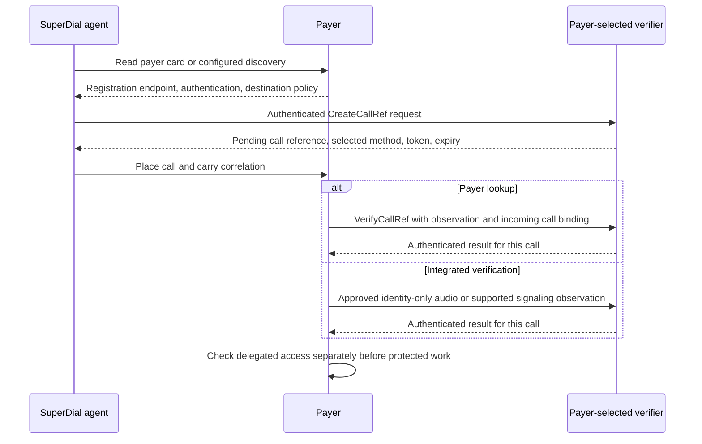

HAP-1 proposes an authenticated API exchange before a phone call, followed by correlation of the incoming call with that registered session.
The agent starts the exchange. The payer selects the registration and verification service.
That service can be the payer itself, Pindrop, or another payer-approved service.
These are proposed roles, not claims of vendor implementation or support.

**Draft version:** `1.0-draft.5`. This voice profile follows the [core identity and access requirements](hap-1.md).
The examples propose a contract for partner review; schemas and independent interoperability checks remain open.

## Separate identity, correlation, and access

| Check | Meaning |
| --- | --- |
| API authentication | The registration service verifies the organization and client making the request. |
| Call correlation | The verifier connects an observed phone call to that authenticated registration. |
| Delegated access | The payer checks trusted authorization records for provider delegation, permitted actions, record limits, and current local policy before protected work. |

A positive call result identifies the caller. The payer still needs verified provider authority before sharing patient or claim information.
The payer or its approved authorization service can keep identity, delegation, and permissions on the server.
The phone call carries a short-lived reference to the authenticated registration.
A call verifier needs separate payer approval before its result can establish delegation or permissions.
If it reports identity only, the payer resolves authorization through its own access workflow.

## Discover where to register

SuperDial often selects a payer phone number from payer information before placing the call.
It can use that payer identity to find a payer-published JSON agent card containing the registration endpoint and supported correlation methods.
The endpoint can point to a service outside the payer's domain when the payer explicitly delegates that role.
HAP does not require a universal registrar or a Pindrop account for every deployment.

[A2A discovery](https://a2a-protocol.org/latest/specification/#82-discovery-mechanisms) supports agent cards at `/.well-known/agent-card.json`, in catalogs, or through direct configuration.
The client first needs an authenticated mapping from the payer to its domain or configured card URL.
A search result or a verifier's own advertisement does not establish that mapping or payer approval.
An allowlisted URL limits where requests go; it does not prove the requesting agent's identity.

The payer's voice discovery information supplies:

- The accepted HAP version, payer identity, registration URL, and verifier identity.
- The destinations covered by that policy, including explicit phone numbers or a configured destination group.
- Client authentication requirements, API credential setup, and supported correlation methods in payer preference order.
- How the payer gets verification results, plus discovery refresh and call-reference expiry rules.

The following is an illustrative HAP metadata fragment for an agreed card extension or configured payer profile.
It is not a complete A2A Agent Card. The extension URI and discovery schema remain open.
The `scope` value is proposed by HAP, not an existing OAuth registration.

```json
{
  "hap_version": "1.0-draft.5",
  "payer_id": "payer-example",
  "voice_registration": {
    "endpoint": "https://verifier.example/hap/call-refs",
    "destinations": ["+12025550123"],
    "authentication": {
      "scheme": "oauth2_client_credentials",
      "token_endpoint": "https://verifier.example/oauth/token",
      "resource": "https://verifier.example/hap",
      "scope": "hap.call.register",
      "client_authentication": "private_key_jwt",
      "presenter_proof": "dpop"
    },
    "correlation_methods": ["dtmf", "spoken_digits"],
    "verification_delivery": "integrated_signal",
    "max_call_ref_lifetime_seconds": 300,
    "discovery_max_age_seconds": 3600
  }
}
```

These example numbers and domains are invented. The registration endpoint checks that the requested destination belongs to its payer policy.
An organization-wide card applies only to the destinations it explicitly covers.
It does not authorize registration for every number associated with a large payer brand.

For specialized or unpublished lines, an authenticated, configured number-to-endpoint mapping can supply the destination policy.
[ENUM/NAPTR](https://www.rfc-editor.org/rfc/rfc6116.html) is a possible later lookup mechanism for deployments starting with only a phone number.
HAP has not defined its DNS namespace, service identifier, ownership validation, or conflict rules.
Publishing a JSON card does not, by itself, solve discovery from an arbitrary phone number.
Missing, expired, or conflicting discovery information produces no HAP-verified call.

## Authenticate the agent without an interactive login

The proposed initial mapping uses [OAuth client credentials](https://www.rfc-editor.org/rfc/rfc6749.html#section-4.4).
SuperDial can authenticate to a payer-selected service such as Pindrop through that mapping.
An interactive user account or login is not part of the call flow.
The service still needs a trusted association between the organization, client identifier, and authentication key or credential.

Key-based authentication and OAuth can be used together.
A client can authenticate at the token endpoint using a signed assertion under [RFC 7523](https://www.rfc-editor.org/rfc/rfc7523.html#section-2.2).
The example uses that approach and [DPoP](https://www.rfc-editor.org/rfc/rfc9449.html) for registration requests.
Other authentication methods need an advertised, agreed profile; an arbitrary self-published key or URL is insufficient.

Registration credentials permit call registration only. They do not authorize protected RCM operations.
Identity and authorization are resolved through trusted server-side records without another HAP credential exchange.
The payer still verifies provider delegation and the requested action before protected work.

## Register once before dialing

The agent calls one registration API, provisionally named `CreateCallRef`, before placing the phone call.
The exchange authenticates the client and returns the correlation instructions together.
There is no separate agent-facing identity-verification API or payer-initiated watermark exchange in this flow.
OAuth credential acquisition remains a separate standard step when needed.

```http
POST /hap/call-refs HTTP/1.1
Host: verifier.example
Authorization: DPoP <registration-access-token>
DPoP: <proof-for-this-request-and-token>
Content-Type: application/json
Idempotency-Key: example-registration-attempt-1
```

```json
{
  "hap_version": "1.0-draft.5",
  "payer_id": "payer-example",
  "destination": "+12025550123",
  "client_call_id": "example-outbound-attempt-1",
  "supported_correlation_methods": ["dtmf", "spoken_digits"]
}
```

The service derives client identity from the authenticated request, not a caller-supplied organization name.
It selects a method supported by both parties under the destination's policy.
If no method matches, it refuses registration rather than silently selecting an unsupported method.

A proposed successful response uses `201 Created` and `Cache-Control: no-store`:

```json
{
  "hap_version": "1.0-draft.5",
  "call_ref": "example-call-ref-1",
  "status": "registered",
  "expires_in": 300,
  "correlation": {
    "method": "dtmf",
    "value": "<one-time-digits>",
    "terminator": "#"
  }
}
```

`registered` means the API accepted a future call. It does not mean the phone call has been verified.
The reference binds the authenticated client, payer, destination, outbound attempt, chosen method, and expiry.
The service stores that binding; the phone token does not need to encode those attributes.
The proposed maximum lifetime is 300 seconds for the first successful correlation.
This lifetime does not extend provider delegation or other authorization limits.

A retry with the same client, idempotency key, and request returns the same registration while it remains valid.
Changing the request under that key produces a conflict.
An expired registration is reported as expired; a new dialing attempt needs a new registration and key.
Short digit tokens need unpredictable allocation, active-session collision handling, and bounded verification attempts.
Token length and retry limits remain pilot decisions.

## Carry the correlation into the call

The agent dials the registered destination and follows the selected method.
DTMF and spoken digits are the initial proposed methods.
The payer's response or configured call flow determines when to send them.
A short token identifies a pending registration; it is not cryptographic proof by itself.

RN/JIP signaling and audio watermarks are candidate extensions requiring agreed encoding, transport, detection, and trust rules.
Their availability depends on the participating telephony systems.
They are not interchangeable with spoken or DTMF tokens without that agreement.

A future carrier-supported profile could associate the registration with STIR/SHAKEN `origid` for correlation at call arrival.
[RFC 8588](https://www.rfc-editor.org/rfc/rfc8588.html#section-5) defines `origid` as a UUID associated with the originating service provider.
It is not an arbitrary application-token field controlled by the agent.
Such a profile needs carrier cooperation, authenticated mapping, signature validation, freshness, and destination checks.
A valid carrier assertion alone does not establish provider delegation or HAP authorization.
Deployments retain their negotiated in-band method when an agreed signaling method is unavailable.

## Verify through the payer's selected integration

The payer chooses either result path. Both use the same authenticated registration and call binding.

| Result path | Behavior |
| --- | --- |
| Payer lookup | The payer observes the correlation and calls an authenticated `VerifyCallRef` interface at its selected verifier. |
| Integrated signal | The selected verifier observes the correlation through its existing payer integration and sends the result to the payer. |

`VerifyCallRef` is a payer-to-verifier interface, not a second API the agent must call.
An existing integration can supply its equivalent without a new public verification endpoint.
Exact lookup and event schemas remain part of the payer integration agreement.

For example, Pindrop could detect an agreed audio token through a forked identity-only audio segment.
RN/JIP observation uses supported signaling metadata rather than assuming those fields exist in the audio.
An audio feed ends before protected discussion, or uses a payer-controlled filter that excludes protected content.
This proposal does not permit sending an unrestricted patient or claim conversation to an external identity service.

The verifier checks the observed method and token against the pending client, payer, destination, expiry, and actual incoming call.
A successful match atomically binds the reference to one payer-side call identifier and consumes the token for other calls.
Repeated delivery for the same call is idempotent. A second call cannot reuse the token.
Missing, ambiguous, expired, replayed, or conflicting observations do not produce a positive result.

The authenticated result identifies the client, payer, destination, call reference, payer-side call, method, outcome, and observation time.
The payer accepts results only from its configured verifier and checks that the result names the current call.
Pending registration, successful audio detection alone, or a result naming a different call is insufficient.
If the integration cannot securely establish that binding, it leaves the call unverified.

## Resolve access from trusted records

The payer uses the verified client identity to find current provider delegation and permissions in its own records or an approved authorization service.
Those checks can happen during registration or through the payer's access workflow after the call is verified.
The registration and short phone token do not need to contain that authorization information.

If the verifier also reports delegation or permissions, the payer must approve it to make those assertions.
The integration must define how that context binds to the verified client and current call, including its validity and revocation rules.
An identity-only verification result does not imply provider authority.

Before each protected operation, the payer checks the requested action, authorized provider, record relationship, and current local blocks.
The first claim-status pilot permits only claims matching the authorized billing-provider NPI.
A provider NPI supplied by the caller does not establish delegation.
Missing, expired, revoked, or unverifiable authorization prevents protected work, including during an already verified call.

The [HTTP access profile](hap-1-http.md) uses standard API authentication and the same payer-side authorization checks for digital requests.

## Complete the verified call



An existing verifier integration can keep payer changes small if it already supports detection, call binding, and result delivery.
That is a deployment condition, not a claim that every current integration supports this flow.
The service can run inside the payer when no intermediary is selected.

## Check the proposed flow

Use invented destinations, client identities, and tokens.

- Discover a payer-hosted endpoint and a payer-designated external endpoint through their respective payer policies.
- Register before dialing, negotiate DTMF or spoken digits, and verify the actual incoming call through each result path.
- Check registration retries, expired references, wrong destinations, unsupported versions, and no shared correlation method.
- Reject untrusted discovery, unknown keys, blocked clients, stale policy, and verifier self-advertisements without payer approval.
- Reject guessed tokens, token reuse on another call, mismatched methods, and results delivered for a different call.
- Keep calls unverified when audio or signaling detection fails or the result channel is unavailable.
- Complete an authorized lookup using the authenticated client identity and trusted server-side delegation and permissions.
- Confirm an identity-only result cannot bypass provider delegation, record limits, revocation, or local payer blocks.
- Reject authorization information from a verifier approved only to establish identity.
- Stop protected work if authority expires, is revoked, or cannot be checked during an already verified call.
- Confirm registration traffic, logs, and external media feeds contain no protected call or business content.

The draft 5 registration examples select the new identity version explicitly.
The [roadmap](../../docs/roadmap.md) tracks discovery serialization, call-binding assurance, media controls, carrier profiles, and conformance work.
