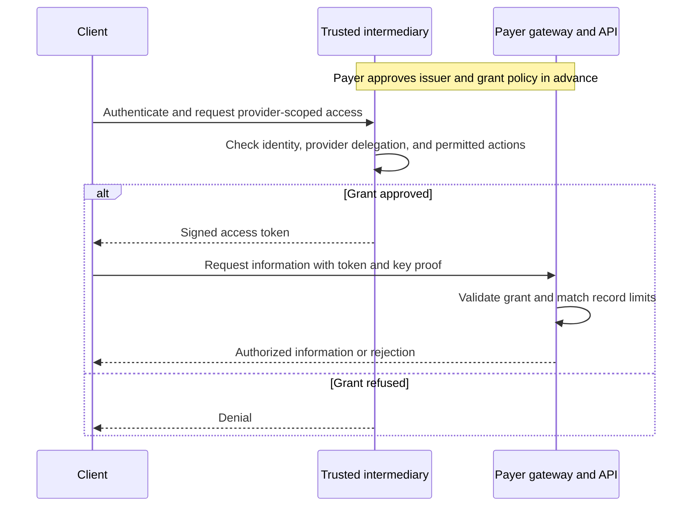

HAP-1 lets a payer accept access grants from trusted intermediaries instead of running its own client authentication process.

The intermediary verifies the client, checks its authority to act for a provider, and issues a signed access token.
The client uses that token to request information directly from the payer.
The payer's gateway validates the token and enforces its limits.

**Draft version:** `1.0-draft.2`. Working draft for partner review; the first proposed pilot supports claim-status reading.

## Who does the work

| Participant | Responsibility |
| --- | --- |
| Client | Enroll with an intermediary, prove control of its key, and request access. |
| Intermediary | Verify the organization and client, verify provider delegation, and issue access grants under the payer's agreed policy. |
| Payer | Choose trusted issuers, accept grants within agreed limits, and return only the authorized information. |

The trust model resembles certificate authorities: the payer relies on an approved issuer instead of repeating its identity checks.
HAP also requires that issuer to verify the client's permission to act for the provider.

## How it works

1. **Agree on trust.** The payer approves an intermediary's signing keys, verification policy, and permitted grant types.
2. **Verify once at enrollment.** The intermediary verifies the client and its provider delegation. It maintains those checks as relationships change.
3. **Get a short-lived grant.** The client authenticates to the intermediary and requests access for an enrolled provider.
4. **Call the payer directly.** The client presents the signed grant and proves control of its key. The payer enforces the grant's limits.

## What the payer implements

A standard gateway or verifier component handles token signatures, trusted issuers, expiry, and proof of key possession.
It also checks the requested action and whether the requested record falls within the grant.
The payer configures this component once for each trust policy.

The payer does not enroll clients, collect their login credentials, ask verification questions, or issue another access token.
Provider delegation checks and access decisions happen at the intermediary under the agreed policy.

The payer keeps a local right to block an issuer, client, provider, or operation.
Its existing rules connect grant identifiers to its own records.

**Credential validation still happens at the payer boundary.** The gateway performs it without a separate payer authentication workflow.

## What an access grant means

A grant identifies the client, provider, intended payer, permitted action, record limits, and expiry time.
An identity certificate alone is insufficient: the intermediary also checks provider delegation and the payer's delegated access policy.

For the first pilot, `claim.status.read` permits reading claims whose billing-provider NPI matches the authorized provider.
The intermediary verifies authority for that provider before issuing the grant.
Other record relationships need an agreed extension.

## Where the data goes

The intermediary handles organization identity, provider delegation evidence, requested permissions, and access grants.
It does not need patient identifiers, claim identifiers, claim payloads, clinical documents, or call audio to make these decisions.
Those data stay between the client and payer.

Provider delegation evidence excludes patient and claim details.
A verifier component that handles business requests runs within the payer's protected environment.
External status checks contain token information only, without claim requests or responses.

## Standards and implementation

The HTTP proposal uses [OAuth client credentials](https://www.rfc-editor.org/rfc/rfc6749.html#section-4.4),
[signed access tokens](https://www.rfc-editor.org/rfc/rfc9068.html), and
[proof of key possession](https://www.rfc-editor.org/rfc/rfc9449.html).
The [HTTP reference](hap-1-http.md) defines the HAP-specific grant fields and trust rules.

Voice and A2A bindings can use the same trust model after they define credential presentation for their channels.

Draft 2 replaces the earlier payer verification sessions and payer-issued access tokens.
Implementations select the exact draft version; the two flows are not interchangeable.
