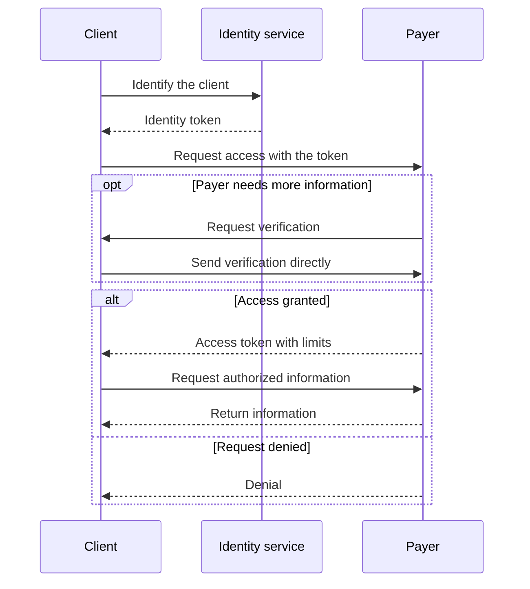

HAP-1 lets an automated client identify itself to a payer and request access to specific information.

For example, an RCM agent wants to check a claim's status.
A trusted identity service confirms which client is making the request.
The payer decides whether to give that client access.
The client gets the claim information directly from the payer.

HAP-1 is a working draft for partner review. The first proposed pilot supports claim-status reading.

## Who takes part

| Participant | What they do |
| --- | --- |
| Client | An RCM agent or other automated caller asks the payer for access. |
| Identity service | Confirms the enrolled client's identity and the organization responsible for it. |
| Payer | Decides which information the client can access and which actions it can take. |

Each payer chooses the identity services it trusts.
The client enrolls with an identity service before using it.

## How it works

1. **Identify the client.** The client signs in to its identity service and gets a short-lived identity token for the intended payer.
2. **Ask for access.** The client presents that token to the payer and requests an action, such as reading claim status.
3. **Complete the payer's checks.** If the payer needs verification information, the client sends it directly to the payer.
4. **Use the granted access.** The payer returns permission for specific actions and records, or denies the request.

## Identity and permission

The identity service confirms who the client is.
The payer decides what that client can do.
These decisions use separate tokens: an identity token from the identity service and an access token from the payer.

The payer checks the client's authority to act for the provider under its own policy.
It can request information such as a member ID, provider NPI, or service date.
Those values help the payer perform its checks; knowing them does not by itself establish authority.

Permission has limits: allowed actions, allowed records, the intended payer service, and an expiry time.
The payer checks those limits on every request.
It can deny access or revoke a previous grant.

## Where the data goes

The identity service handles client identity only.
Requested claim permissions, verification answers, access grants, and claim information pass directly between the client and payer.

The identity service does not receive patient details, claim documents, or recordings and transcripts containing protected information.
This boundary also applies to logs and any audio feed used for identity checks.

## What the first pilot supports

The initial permission is `claim.status.read`: reading claim status within the records the payer authorizes.
Claim submission, changes, payment, and appeals need separate permissions and business operations.

The first technical proposal uses HTTP.
Voice workflows can use the same identity model after a voice binding defines how identity connects securely to a live call.
A2A can carry later agent tasks when both parties support it.

## Use existing security standards

HAP-1 uses established mechanisms for the security work:

| Mechanism | What it does |
| --- | --- |
| [OAuth 2.0 client credentials](https://www.rfc-editor.org/rfc/rfc6749.html#section-4.4) | Lets an enrolled client authenticate to its identity service. |
| [Signed JWTs](https://www.rfc-editor.org/rfc/rfc7519.html) with [JWT security practices](https://www.rfc-editor.org/rfc/rfc8725.html) | Carry identity information that the payer can validate. |
| [DPoP](https://www.rfc-editor.org/rfc/rfc9449.html) | Binds tokens to the client's key, so a copied token alone is insufficient. |

The [HTTP reference](hap-1-http.md) defines the HAP-specific fields, endpoints, permissions, and time limits.
It links to the underlying standards for their validation rules.
