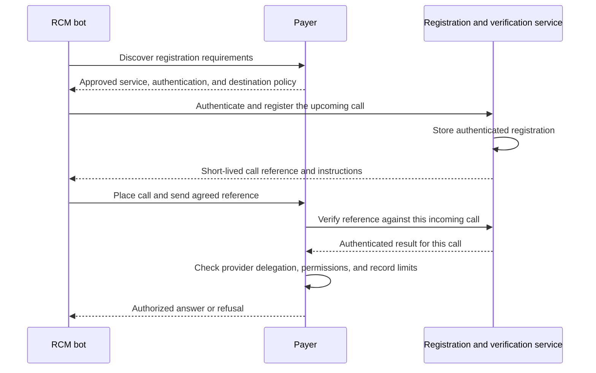

HAP-1 is intended to cover shared RCM business operations, including their requests, results, and supporting access rules.
This page describes its identity and access profile.
The [business capabilities](/docs/capabilities) describe the broader scope; the [claim-status contract](/spec/claims/claim-status) defines the first business operation.

For phone calls, an agent authenticates before calling a payer, then connects that registration to the incoming call.
The payer checks the agent's permission to act for a provider before sharing protected information.

Identity and authorization information can stay with the payer or its approved service.
The agent carries a short-lived call reference through DTMF, spoken digits, or an agreed signaling method.
HTTP clients use standard API authentication. HAP adds no separate access credential or issuance exchange.

**Draft version:** `1.0-draft.1`. Working draft for partner review; the first proposed business pilot supports claim-status reading.

For phone calls, the agent registers a session through an authenticated API before dialing.
The payer selects the service and correlation method through its discovery policy.
The [pre-call authentication profile](/spec/identity/hap-1-voice) describes this exchange and both payer verification paths.
Call identity, call correlation, and delegated data access are separate checks.

## Core requirements

- The registration service MUST authenticate the client before accepting a call registration.
- For voice, each payer MUST publish its accepted authentication methods, registration service, and destination policy.
- The verifier MUST bind the authenticated registration to the actual incoming call, with expiry and replay checks.
- The payer MUST verify provider delegation, permitted actions, record limits, and current local policy before protected work.
- A payer MAY use an approved intermediary. The protocol MUST NOT require a named intermediary or external authorization service.

These checks use trusted server-side records and authenticated verification results.
API authentication still needs an accepted key or credential. A call reference does not replace that authentication.
Discovery and call registration do not authorize a lookup or release protected results.

## Who does the work

| Participant | Responsibility |
| --- | --- |
| Client | Discover payer requirements, authenticate to the registration service, register before dialing, and carry the call reference. |
| Call verifier, when selected | Authenticate call registration, match incoming calls to registered sessions, and report results to the payer. |
| Authorization service, when selected | Maintain verified provider delegation and permissions under the payer's approved policy. |
| Payer | Publish accepted methods, verify calls, check provider authority, and enforce action and record limits. |

Recognizing the bot's identity alone does not establish that permission.
A call verifier needs separate payer approval before its result can establish provider delegation or permissions.
The payer can maintain that authorization information itself.

## Discover the registration service

The client starts with the payer identity it uses to select the destination phone number.
A payer-published JSON agent card can advertise its registration URL, accepted client authentication, covered numbers, and correlation methods.
The URL can name the payer, Pindrop, or another payer-approved service.
No universal registrar is required, and these examples do not claim vendor support.

The client authenticates the payer-to-card mapping before trusting an advertised service.
A configured destination mapping can cover specialized lines that are not publicly listed.
Per-number ENUM/NAPTR discovery remains a proposed extension when the client knows only a phone number.
HAP has not defined that DNS profile or a final Agent Card extension schema.

## Pre-call voice authentication

1. **Discover the endpoint.** The client reads the payer's card or authenticated configuration for the selected destination.
2. **Register before dialing.** The client authenticates to the selected service and calls `CreateCallRef`.
3. **Get correlation instructions.** The service returns a pending session token, expiry, and a mutually supported correlation method.
4. **Place the phone call.** The client carries that correlation through DTMF, spoken digits, or an explicitly agreed signaling method.
5. **Verify the incoming call.** The payer calls `VerifyCallRef`, or its selected verifier detects the correlation and sends an authenticated result.
6. **Check access.** The payer uses trusted authorization information to verify provider delegation, permitted actions, and record limits before protected work.

One agent-facing registration exchange authenticates the request and issues the call reference.
`VerifyCallRef`, when needed, is a separate payer-to-verifier interface; an existing verifier integration can deliver the result instead.
The payer does not need to start an exchange after detecting a watermark.
In-band detection still occurs after the call connects when that is the selected method.

OAuth client credentials can support registration without an interactive login.
Key-based client authentication can use signed assertions within OAuth; the service still needs a trusted organization-to-key association.
URL allowlisting selects acceptable endpoints but does not authenticate an agent by itself.

RN/JIP, watermark, and STIR/SHAKEN `origid` correlation need agreed telephony profiles before use.
An integrated verifier can inspect an identity-only audio segment or supported signaling and report a result for the actual payer-side call.
An unrestricted fork of protected call audio is outside this proposal's data boundary.
The [voice profile](/spec/identity/hap-1-voice) gives examples, failure rules, and the remaining interoperability decisions.

## Keep authorization on the server

The registration service stores the authenticated client, payer, destination, call attempt, selected method, and expiry against the call reference.
The phone token can be an opaque reference to that record.
It does not need to contain a signed identity document or access grant.

Provider delegation and permissions can live in the payer's records or an approved authorization service.
They can be checked during registration or through the payer's existing access workflow after call verification.
If registration establishes identity only, the payer still checks delegation before protected work.

The payer accepts authorization information only from sources it has approved for that purpose.
It checks current authority and local blocks before each protected operation.
Missing, expired, revoked, or unverifiable authority does not permit access.

### Payer-selected verification service

The service can run within the payer or at an approved partner.
The payer gets an authenticated verification result through a lookup or its existing integration.
That result must name the actual payer-side call.

Accepted delegation evidence can include a verified enrollment relationship or a signed provider delegation.
Possession of an NPI, member details, or claim facts alone does not establish provider-to-bot authority.
An invalid or insufficient payload does not permit protected work.

## What the payer implements

A payer configures its registration service, call-verification integration, and trusted authorization sources.
It can use its existing IVR or representative workflow to check provider authority and answer the call.
The integration must securely connect the verification result to that call before relying on the authenticated identity.

The payer keeps a local right to block a service, client, provider, or operation.
Its record-access checks run within its protected environment.
A trusted identity result never overrides local payer access rules.

## What authorization covers

Authorization identifies the client, provider, intended payer, permitted action, record limits, and applicable expiry or revocation conditions.
The payer resolves these facts from trusted records associated with the authenticated client.

For the first pilot, `claim.status.read` permits reading claims whose billing-provider NPI matches the authorized provider.
The payer or its approved authorization service verifies authority for that provider before permitting the lookup.
Other record relationships need an agreed extension.

## Where the data goes

When used, an external service handles organization identity, approved provider delegation evidence, permissions, and verification metadata.
It does not need patient identifiers, claim identifiers, claim payloads, clinical documents, or call audio to make these decisions.
Those data stay between the client and payer.

Provider delegation evidence excludes patient and claim details.
Evidence containing patient information in a direct payer verification flow stays between the originating system, client, and payer.
A verifier component that handles business requests runs within the payer's protected environment.
External verification and authorization-status checks contain identity and access metadata only, without claim requests or responses.

## Optional payload encryption

End-to-end payload encryption is an optional implementation choice.
The core flow also works when the client can read the lookup payload.
Transport security, authenticated requests, verified provider delegation, and payer authorization remain required.

A practice system can encrypt lookup identifiers for the receiving payer.
The RCM bot forwards the encrypted payload without reading those identifiers.
This pattern can reduce plaintext PHI exposure to the bot and other forwarding systems.
It does not establish that the bot handles no PHI: permitted results and metadata can still contain sensitive information.

An encrypted deployment binds the lookup payload to the authenticated client, intended payer, permitted action, and current authorization context.
The payer verifies authorization before releasing data.
If the payload is encrypted, the payer decrypts it before checking record access.

An encrypted deployment needs an agreed profile between the originating system and payer.
[JSON Web Encryption (JWE)](https://www.rfc-editor.org/rfc/rfc7516.html) is one possible envelope format.
Selecting JWE alone does not define an interoperable HAP encryption profile.
Key discovery, rotation, algorithm choices, capability negotiation, payload binding, and error rules remain future profile work.

This section describes an optional privacy pattern for the current draft.
It adds no encryption fields or requirements to call registration.

## Standards and implementation

The registration proposal uses [OAuth client credentials](https://www.rfc-editor.org/rfc/rfc6749.html#section-4.4) and
[proof of key possession](https://www.rfc-editor.org/rfc/rfc9449.html) on the API channel.
These standard API mechanisms establish the authenticated client without another HAP credential exchange.

The [voice proposal](/spec/identity/hap-1-voice) adds pre-call registration and correlation under the same payer-controlled trust model.
The [claim-status contract](/spec/claims/claim-status) defines the business requests and results under the same pinned draft.

### HTTP requests

The [HTTP access profile](/spec/identity/hap-1-http) uses standard API authentication and payer-side authorization under `1.0-draft.1`.
Its OAuth example uses an ordinary API access token, which can be an opaque reference to server-side state.
HAP defines no custom token claims or separate grant exchange.
The published A2A Agent Card selects `1.0-draft.1` for the identity profile and claim-status contract.
The current business schemas and examples use the same pinned version.

### Current draft

The protocol, current business contracts, schemas, and examples are pinned to `1.0-draft.1`.
Implementations select that exact version through payer discovery.
