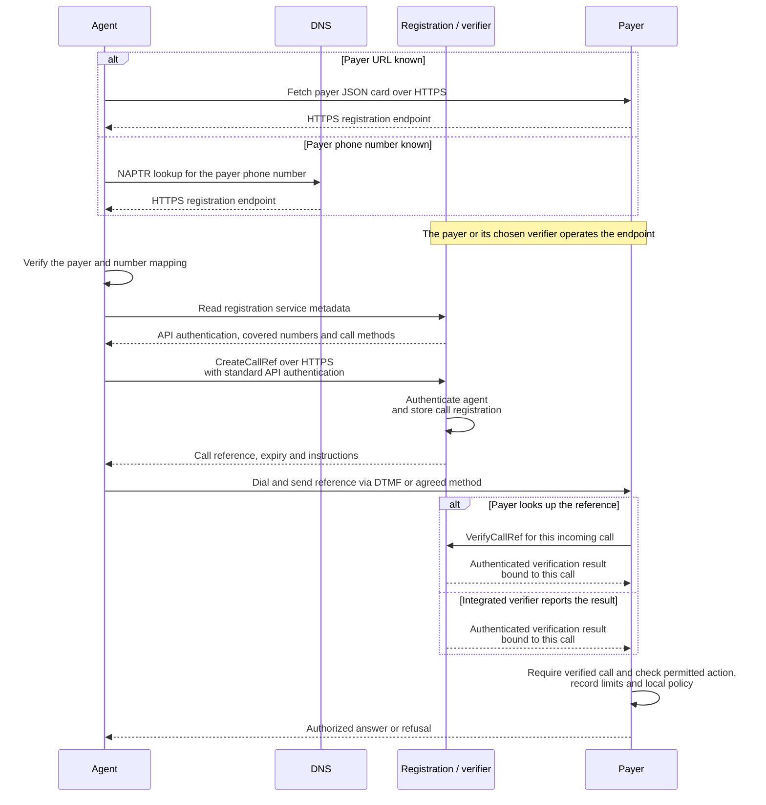

**Draft:** `1.0-draft.1`.

An agent must prove who it is.
The payer decides what the authenticated client can do and which records it can access.
Identity and permissions stay in server-side records.

## Find the registration endpoint

Phone registration is an out-of-band HTTPS request made before dialing.
The first step is finding where the payer wants that request sent.

| What the agent knows | How it finds the endpoint |
| --- | --- |
| The payer's URL | Fetch the payer's JSON card. The card advertises the HTTPS registration endpoint. |
| The payer's phone number | Map the number to a DNS lookup name and query its NAPTR record. The matching record resolves to the HTTPS registration endpoint. |

The endpoint can be operated by the payer itself or its chosen verification service.
Different payers or phone lines can select different services; there is no required central registrar.
The agent uses the published mapping to choose where to register.

The selected service publishes its accepted API authentication, covered phone numbers, and supported call-correlation methods.
Before sending credentials, the agent verifies that the card or DNS mapping is authorized for the intended payer and destination number.
If that mapping is missing or cannot be verified, registration cannot proceed.

The phone-number route uses DNS [NAPTR records](https://www.rfc-editor.org/rfc/rfc3403.html) with an [ENUM-style number-to-DNS mapping](https://www.rfc-editor.org/rfc/rfc6116.html).
The card location and fields, DNS namespace, NAPTR service tag, and registration message formats still need to be specified in draft 1.

## API requests

Use the payer's published API authentication over HTTPS, such as OAuth client credentials with an ordinary access token.
HAP adds no separate credential or grant exchange.
Tokens can be opaque references to server-side records.

For business API requests, the payer's card also publishes its API endpoints, scopes, and access rules.
If the payer requires sender-constrained tokens, clients must use that method.

## Phone calls

The agent authenticates over an API before dialing.
The phone call carries a short reference that connects it to that authenticated registration.

1. Discover the HTTPS registration endpoint through the payer's JSON card or a phone-number NAPTR lookup. Read the service's authentication, covered numbers, and correlation methods.
2. Authenticate to that service and register the upcoming call with `CreateCallRef`. Receive a call reference, expiry, and instructions.
3. Call the payer and send the reference using DTMF, spoken digits, or an agreed signaling method.
4. The payer verifies the reference against the actual incoming call using `VerifyCallRef` or an authenticated result from its integrated verifier.
5. The payer checks the client's permissions before doing protected work.

The payer can run verification itself or choose an approved service.
RN/JIP signaling and audio watermarks require an agreed integration; they are not assumed to work on every call.

A reference expires within five minutes unless matched to a call, and can match only one call.
The service binds it to the authenticated client, payer, destination, and call attempt.
References must be unpredictable, with bounded guessing attempts.
Matching consumes the registration atomically; retries for the same call are idempotent.
Expired, replayed, mismatched, or ambiguous references fail verification.
A verified call does not by itself grant data access.

## What the payer checks

Before each protected operation, including retries and later result retrieval, the payer checks:

- The authenticated client's identity and current permissions.
- The permitted action, record limits, and any local access blocks.
- Expiry or revocation of credentials and permissions. Missing or unverifiable permissions do not permit access.

For `claim.status.read`, the payer must authorize access to the requested claim before looking it up.

## Data handling

Patient and claim data pass between the client and payer.
External verification services receive identity and call metadata, not claim requests or results.
If verification uses audio, the external service receives only the identity segment, ending before protected information is discussed.
Keep credentials out of discovery documents, URLs, and logs.
Payload encryption is optional and needs an agreed profile; it does not replace access checks.
