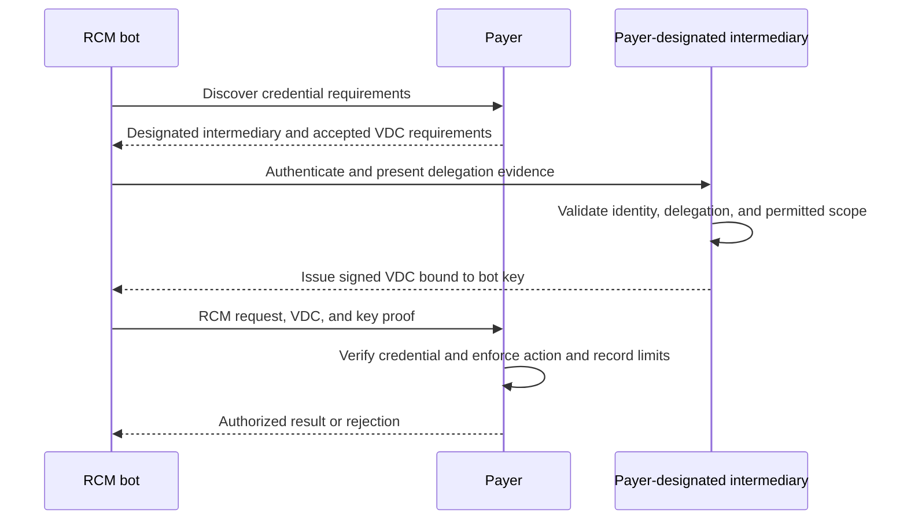
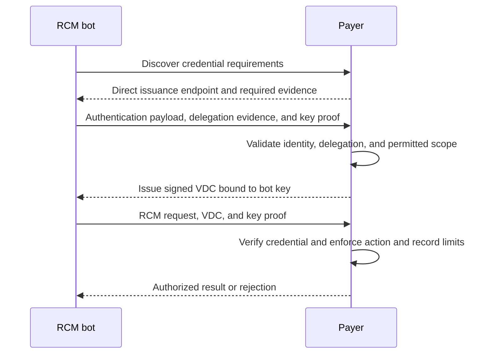
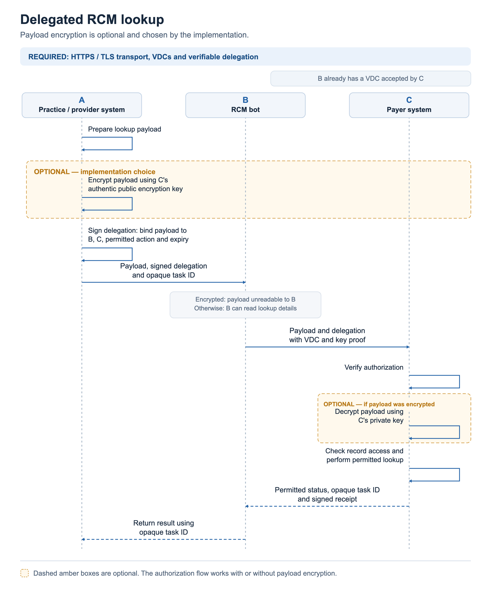

HAP-1 proposes agent-initiated pre-call authentication and requires a verifiable digital credential (VDC) for protected delegated RCM operations.

Each payer chooses its accepted issuers and authentication requirements.
A payer can issue VDCs directly, require a trusted intermediary, or accept both paths.
The protocol does not require a particular intermediary or require every payer to offer direct issuance.

**Draft version:** `1.0-draft.4`. Working draft for partner review; the first proposed business pilot supports claim-status reading.

For phone calls, the agent registers a session through an authenticated API before dialing.
The payer selects the service and correlation method through its discovery policy.
The [pre-call authentication profile](hap-1-voice.md) describes this exchange and both payer verification paths.
Call identity, call correlation, and delegated data access are separate checks.

## Core requirements

- A client MUST present a payer-accepted VDC before the payer performs a delegated RCM operation.
- The credential issuer MUST verify the client's identity and its authority to act for the provider.
- Each payer MUST publish its accepted issuers and credential acquisition requirements.
- A payer MAY require a designated intermediary. The protocol MUST NOT require a named intermediary or third-party issuer.
- The payer MUST enforce credential validity, key possession, permitted actions, record limits, and local access policy.

The signed access grant is the VDC in the proposed HTTP profile.
This HAP usage does not establish AP2 or W3C credential-format conformance.
Credential discovery and acquisition happen before protected RCM operations and do not require an existing HAP access VDC.
Those bootstrap steps do not authorize a lookup or release protected results.

## Who does the work

| Participant | Responsibility |
| --- | --- |
| Client | Discover payer requirements, register calls before dialing, present accepted evidence, get an access VDC, and prove key control. |
| Call verifier, when selected | Authenticate call registration, match incoming calls to registered sessions, and report results to the payer. |
| Intermediary, when selected | Verify identity and provider delegation, then issue a VDC under the payer's approved policy. |
| Payer | Publish accepted paths, verify requests, enforce record limits, and issue VDCs when it offers direct issuance. |

An issuer must verify the client's permission to act for the provider.
Recognizing the bot's identity alone does not establish that permission.
A call verifier is not automatically an accepted VDC issuer.

## Discover the registration service

The client starts with the payer identity it uses to select the destination phone number.
A payer-published JSON agent card can advertise its registration URL, accepted client authentication, covered numbers, and correlation methods.
The URL can name the payer, Pindrop, or another payer-approved service.
No universal registrar is required, and these examples do not claim vendor support.

The client authenticates the payer-to-card mapping before trusting an advertised service.
A configured destination mapping can cover specialized lines that are not publicly listed.
Per-number ENUM/NAPTR discovery remains a proposed extension when the client knows only a phone number.
HAP has not defined that DNS profile or a final Agent Card extension schema.

## Pre-call voice authentication

1. **Discover the endpoint.** The client reads the payer's card or authenticated configuration for the selected destination.
2. **Register before dialing.** The client authenticates to the selected service and calls `CreateCallRef`.
3. **Get correlation instructions.** The service returns a pending session token, expiry, and a mutually supported correlation method.
4. **Place the phone call.** The client carries that correlation through DTMF, spoken digits, or an explicitly agreed signaling method.
5. **Verify the incoming call.** The payer calls `VerifyCallRef`, or its selected verifier detects the correlation and sends an authenticated result.
6. **Check access separately.** The payer enforces the accepted VDC, provider delegation, record limits, and local policy before protected work.

One agent-facing registration exchange authenticates the request and issues the call reference.
`VerifyCallRef`, when needed, is a separate payer-to-verifier interface; an existing verifier integration can deliver the result instead.
The payer does not need to start an exchange after detecting a watermark.
In-band detection still occurs after the call connects when that is the selected method.

OAuth client credentials can support registration without an interactive login.
Key-based client authentication can use signed assertions within OAuth; the service still needs a trusted organization-to-key association.
URL allowlisting selects acceptable endpoints but does not authenticate an agent by itself.

RN/JIP, watermark, and STIR/SHAKEN `origid` correlation need agreed telephony profiles before use.
An integrated verifier can inspect an identity-only audio segment or supported signaling and report a result for the actual payer-side call.
An unrestricted fork of protected call audio is outside this proposal's data boundary.
The [voice profile](hap-1-voice.md) gives examples, failure rules, and the remaining interoperability decisions.

## How it works

The following steps establish delegated access for digital requests.
The phone-call flow above adds correlation; its token does not replace the access VDC.

1. **Start with the payer.** The client gets credential requirements from the payer's authenticated discovery information.
2. **Follow the payer's policy.** The client selects an advertised path and supplies the evidence that path requires.
3. **Get a short-lived VDC.** The selected issuer validates identity, provider delegation, and permitted actions before issuance.
4. **Call the payer.** The client presents the VDC and key proof. The payer enforces its limits before returning data.

The payer controls discovery even when an intermediary hosts the credential endpoint.
Clients can cache valid payer requirements and reuse an unexpired accepted VDC when payer policy permits.
They do not need to repeat issuance before every operation.

### Payer-designated intermediary

If the payer requires an intermediary, the client authenticates with that intermediary.
The intermediary issues a VDC that the payer accepts directly.
The payer does not mint a replacement VDC for that path.

### Direct payer issuance

If the payer offers direct issuance, the client presents its authentication payload and delegation evidence directly to the payer.
The payer validates that evidence and issues the VDC itself.
No trusted intermediary participates in this path.

Accepted evidence can include an approved practice credential or a signed provider delegation.
Possession of an NPI, member details, or claim facts alone does not establish provider-to-bot authority.
An invalid or insufficient payload does not produce a VDC or permit protected work.

## What the payer implements

A standard gateway or verifier component handles token signatures, trusted issuers, expiry, and proof of key possession.
It also checks the requested action and whether the requested record falls within the grant.
The payer configures this component once for each trust policy.

With intermediary issuance, the intermediary performs client authentication and delegation checks under the payer-approved policy.
The payer accepts that VDC without another issuance step.
With direct issuance, the payer performs those checks and issues the VDC through its own credential endpoint.

The payer keeps a local right to block an issuer, client, provider, or operation.
Its existing rules connect grant identifiers to its own records.

**Credential validation happens at the payer boundary in both paths.** An accepted issuer never overrides local payer access rules.

## What an access grant means

A grant identifies the client, provider, intended payer, permitted action, record limits, and expiry time.
An identity certificate alone is insufficient: the issuer also checks provider delegation and the payer's access policy.

For the first pilot, `claim.status.read` permits reading claims whose billing-provider NPI matches the authorized provider.
The issuer verifies authority for that provider before issuing the VDC.
Other record relationships need an agreed extension.

## Where the data goes

When used, the intermediary handles organization identity, provider delegation evidence, requested permissions, and its issued VDCs.
It does not need patient identifiers, claim identifiers, claim payloads, clinical documents, or call audio to make these decisions.
Those data stay between the client and payer.

Provider delegation evidence excludes patient and claim details.
Evidence containing patient information in a direct payer verification flow stays between the originating system, client, and payer.
A verifier component that handles business requests runs within the payer's protected environment.
External status checks contain token information only, without claim requests or responses.

## Optional payload encryption

End-to-end payload encryption is an optional implementation choice.
The core flow also works when the client can read the lookup payload.
Transport security, the signed access grant, and verified provider delegation remain required.

A practice system can encrypt lookup identifiers for the receiving payer.
The RCM bot forwards the encrypted payload without reading those identifiers.
This pattern can reduce plaintext PHI exposure to the bot and other forwarding systems.
It does not establish that the bot handles no PHI: permitted results and metadata can still contain sensitive information.

The following example names A as the practice system, B as the RCM bot, and C as the payer.
It assumes B already holds a payer-accepted verifiable digital credential (VDC), represented by the signed access grant in this draft.

The originating system binds its signed authorization to the lookup payload, bot key, intended payer, permitted action, and expiry.
The payer verifies authorization before releasing data.
If the payload is encrypted, the payer decrypts it before checking record access.

An encrypted deployment needs an agreed profile between the originating system and payer.
[JSON Web Encryption (JWE)](https://www.rfc-editor.org/rfc/rfc7516.html) is one possible envelope format.
Selecting JWE alone does not define an interoperable HAP encryption profile.
Key discovery, rotation, algorithm choices, capability negotiation, payload binding, and error rules remain future profile work.

This section describes a privacy pattern for v0.
It adds no encryption fields or requirements to the draft HTTP wire contract.
The [roadmap](../../docs/roadmap.md#optional-privacy-profile-after-v0) lists the deferred profile work.

## Standards and implementation

The HTTP proposal uses [OAuth client credentials](https://www.rfc-editor.org/rfc/rfc6749.html#section-4.4),
[signed access tokens](https://www.rfc-editor.org/rfc/rfc9068.html), and
[proof of key possession](https://www.rfc-editor.org/rfc/rfc9449.html).
The [HTTP reference](hap-1-http.md) defines the HAP-specific grant fields and trust rules.

The [voice proposal](hap-1-voice.md) adds pre-call registration and correlation under the same payer-controlled trust model.
The [claim-status contract](../claims/claim-status.md) defines VDC presentation for its proposed A2A 1.0 binding.
Voice still needs its own access VDC presentation and credential-control mapping before protected operations.

[AP2's authorization framework](https://ap2-protocol.org/ap2/agent_authorization/) informs the separation of delegation, action authorization, and credential issuance.
HAP's required VDCs, healthcare permissions, and issuance policy are this draft's contract; base A2A does not impose them.

Draft 4 adds agent-initiated call registration, payer-card discovery, and explicit call verification paths.
It retains draft 3's direct and intermediary VDC issuance paths and optional payload encryption pattern.
The HTTP profile uses the same VDC presentation rules for both accepted issuer roles.
Implementations select the exact advertised draft version. Earlier drafts are not interchangeable with draft 4.
