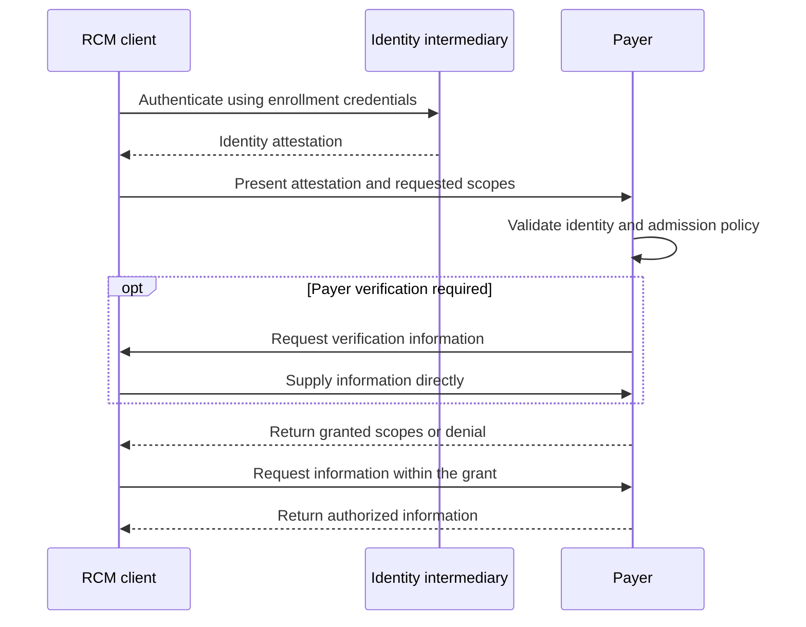

HAP-1 lets a payer verify an automated caller's identity and grant scoped access through the payer's own verification process. The caller and payer exchange all claim data directly. The trusted intermediary vouches for identity only.

| Item | Value |
| - | - |
| Status | Working draft for partner review |
| Revision | 0.1 |
| Protocol version | `1.0-draft.1` |
| Updated | November 2, 2026 |
| Audience | Payers, RCM companies, identity intermediaries, and contact center vendors |
| First pilot | Claim status access |

The core requirements below reflect the proposed HAP-1 architecture. The HTTP binding supplies concrete wire details for an initial pilot. These details are draft choices, not an existing industry standard or a claim of vendor support.

# Overview

HAP-1 defines four boundaries:

1. A trusted intermediary attests to the caller's identity.

2. The payer decides whether to accept that caller.

3. The payer grants access after any required payer verification.

4. Claim data stays between the caller and payer.

A payer can use HAP-1 with a voice workflow or a digital interface. The core does not require A2A, UCP, a shared directory, or changes to an adjudication engine.

Modality switching, interoperability between intermediaries, and shared handles are optional extensions. They are not requirements for the first implementation.

## Requirement language

MUST, MUST NOT, SHOULD, SHOULD NOT, and MAY carry the meanings defined by [RFC 2119](https://www.rfc-editor.org/rfc/rfc2119.html) and [RFC 8174](https://www.rfc-editor.org/rfc/rfc8174.html).

A binding maps the core requirements to a specific channel. Each deployment MUST name its binding and protocol version.

# Participants

| Participant | Responsibility | Authority boundary |
| - | - | - |
| Client | An RCM bot or other automated caller requests access and supplies required verification information. | It cannot grant itself access. |
| Intermediary | A trusted identity service authenticates an enrolled client and issues an identity attestation. | It does not grant payer access or handle claim data. |
| Payer | The recipient validates identity, applies admission policy, performs payer verification, and grants scopes. | It controls access to its records and operations. |
| Consortium | Participating organizations maintain the specification, shared scope definitions, and conformance rules. | Membership does not itself grant access to payer records. |

Pindrop is an example of a potential intermediary. Superdial is an example of a client. These examples describe roles, not announced integrations.

Each payer MUST explicitly configure the intermediary issuers it trusts. A client MUST enroll separately with each intermediary it uses. Automatic trust between intermediaries is outside the core.

# Core flow



1. The client authenticates to an enrolled intermediary.

2. The intermediary issues an identity attestation for the intended payer.

3. The client presents that attestation directly to the payer.

4. The client sends its requested scopes directly to the payer.

5. The payer validates the attestation and applies its admission policy.

6. If necessary, the payer requests verification information.

7. The client sends that information directly to the payer.

8. The payer returns granted scopes or denies access.

9. The client and payer exchange information within the resulting grant.

The payer MAY validate a signed attestation locally. An identity validation service MAY provide token status when the deployment requires it. Such requests MUST contain identity information only.

A payer MUST NOT treat an identity attestation as permission to access a claim.

# Data boundaries

The intermediary handles enrollment credentials, registered client identity, signing keys, and identity attestations. It MAY receive the intended payer identifier and token status information.

The intermediary MUST NOT receive:

- Member identifiers, claim identifiers, or patient information.

- Payer verification answers.

- Claim requests, responses, documents, or clinical details.

- Record-specific access grants.

- Recordings or transcripts containing those data.

Claim scopes, payer verification, and access grants MUST pass directly between the client and payer.

Public metadata, scope strings, and identity attestations MUST NOT contain PHI. Implementations MUST NOT encode PHI into supposedly opaque identifiers.

## Audio boundary

A deployment MUST NOT fork claim-bearing audio to the identity intermediary. The same rule applies to audio containing payer verification answers.

If an audio feed supports identity verification, the deployment MUST prevent protected content from entering that feed. Payer-local software MAY validate identity without sending call content to the intermediary.

HAP-1 does not require an intermediary to hear a call. A voice binding can correlate the call with digital identity proof.

## Operational records

Intermediary logs MUST contain identity events only. Client and payer operational logs MUST omit verification answers, claim payloads, credentials, and tokens.

Payers MAY retain business records within their protected systems under their own retention policy.

# Enrollment and identity attestation

## Enrollment

The intermediary MUST verify the organization that controls each client identity. It MUST bind enrollment credentials to that identity.

Enrollment criteria MAY include organization verification and supporting compliance documentation. Enrollment MUST NOT imply access to any payer's records.

The intermediary MUST support credential suspension and revocation. A payer MAY reject an enrolled client under its own policy.

## Credential roles

| Credential | Issuer | Recipient | Purpose |
| - | - | - | - |
| Enrollment credential | Intermediary | Client | Authenticate the client to the intermediary. |
| Identity attestation | Intermediary | Client for presentation to a payer | Prove the enrolled client identity. |
| Access credential or session grant | Payer | Client | Permit specified operations on records within payer-defined limits. |

An enrollment credential MUST NOT be sent to a payer. A payer MUST distinguish identity attestations from its access credentials.

## Attestation requirements

An attestation MUST carry or securely reference these properties:

| Property | Meaning |
| - | - |
| Issuer | The trusted intermediary that issued the attestation. |
| Subject | The enrolled client identity, unique within that issuer. |
| Organization | The organization responsible for that client. |
| Audience | The intended payer identity-validation service. |
| Issue and expiry times | The interval during which the payer can accept the attestation. |
| Token identifier | An unpredictable identifier for status and replay controls. |
| Presenter binding | Evidence that the presenter controls the credential associated with the attestation. |
| Protocol version | The HAP-1 version governing the attestation. |

The issuer and subject together form the client identity. Matching subject strings from different issuers MUST NOT imply the same client.

The attestation MUST NOT contain claim scopes, record references, or payer verification answers. It MUST NOT assert permission to access payer records.

## Validation

Before accepting an attestation, the payer MUST check its issuer, authenticity, audience, validity interval, protocol version, and presenter binding.

The payer MUST use keys from an explicitly trusted issuer configuration. A token-supplied key URL MUST NOT establish trust.

An expired or invalid attestation MUST fail identity verification. A payer MUST NOT silently treat the client as verified after such failure.

Bindings MUST define replay protection. A spoken code or watermark alone MUST NOT establish client identity.

## Proposed HTTP attestation

The draft HTTP binding uses a signed JWT. JWT fields follow [RFC 7519](https://www.rfc-editor.org/rfc/rfc7519.html). Validation follows [RFC 8725](https://www.rfc-editor.org/rfc/rfc8725.html).

The draft selects ES256 for signatures. The JOSE `typ` value is `hap-identity+jwt`. This is a proposed HAP type, not an IANA registration.

The JOSE header MUST include `kid` for a configured issuer key. Payers MUST reject unsigned tokens, unsupported algorithms, and incorrect token types.

The intermediary MUST limit attestation lifetime to 300 seconds. The payer MAY allow at most 30 seconds of clock skew.

The following decoded payload illustrates the field layout. Values are synthetic; placeholders are not usable credentials.

```json
{
  "iss": "https://identity.example",
  "sub": "client_example",
  "client_id": "client_example",
  "organization_id": "organization_example",
  "aud": "https://payer.example/hap/v1",
  "iat": 1793662200,
  "exp": 1793662500,
  "jti": "attestation_example",
  "scope": "hap.identity",
  "hap_version": "1.0-draft.1",
  "cnf": {
    "jkt": "<client-public-key-thumbprint>"
  }
}
```

The fixed OAuth scope `hap.identity` permits identity presentation at the payer's HAP session service only. It is not a claim scope.

# Payer verification and authorization

## Requested and granted scopes

Requested scopes state which operations the client wants. Granted scopes state which operations the payer permits.

The initial shared scope is `claim.status.read`. It permits reading claim status within the payer's authorized record set. It does not permit claim changes or submissions.

A payer MUST return granted scopes explicitly. Every granted scope MUST appear in the request. Unknown or unsupported scopes MUST NOT be granted.

A payer MAY grant a strict subset. If the granted set is empty, it MUST deny access.

The payer MUST bind each grant to record permissions. An operation scope does not independently authorize every record of that type.

Broader provider-level access MAY follow payer policy. The grant still MUST have explicit record boundaries.

## Payer verification

Payer verification means the payer requests information that its policy requires before granting access.

Examples of requested information include member ID, provider identifiers, and service dates. The client sends all values directly to the payer.

The payer decides which combination is sufficient. HAP-1 does not prescribe that knowledge of any single field is sufficient.

The payer MAY omit payer verification when existing evidence supports the requested access.

If verification fails, the payer MUST NOT issue an access grant. Verification errors MUST NOT disclose record existence to an unauthorized client.

## Grants and continued enforcement

A grant MUST bind the verified client, granted scopes, record permissions, intended payer service, and expiry.

The payer MUST check these limits on each protected request. It MUST support denial, expiry, and revocation.

The payer MUST NOT accept an intermediary identity token as a claim access token. The intermediary MUST NOT receive the payer's access credential.

Additional records or operations MAY require a new authorization decision. The client MUST NOT infer permission from a previous successful request.

A session identifier is a correlation value. It is not a credential.

## Session states

| State | Meaning | Access credential |
| - | - | - |
| `payer_verification_required` | The payer needs verification information. | Absent |
| `granted` | The payer permits a nonempty scope set within defined record limits. | Present for the HTTP binding |
| `denied` | The payer refused the request. | Absent |
| `expired` | The session or grant exceeded its lifetime. | Unusable |
| `revoked` | The payer withdrew the session or grant. | Unusable |

An HTTP grant has a maximum lifetime of 900 seconds in this draft. A payer MAY choose a shorter lifetime.

A new identity attestation MUST NOT automatically extend an existing grant.

# HTTP binding proposal

This section defines a proposed pilot binding. The endpoint paths, time limits, and field names are draft choices for review.

Deployments configure endpoints and trusted issuers directly. Public discovery and directory handles are not required.

All endpoints MUST use HTTPS. JSON messages MUST use `application/json`. Token responses and session responses MUST use `Cache-Control: no-store`.

Session requests MUST include `hap_version`. The payer MUST reject unsupported versions before starting payer verification.

## Presenter proof

The HTTP binding uses OAuth DPoP to bind tokens to the client's key. Issuance and presentation MUST follow [RFC 9449](https://www.rfc-editor.org/rfc/rfc9449.html).

The issuer authenticates enrollment credentials separately from the DPoP proof. It binds the identity token to the proof key.

The payer MUST validate the proof and its token binding on every session request. It MUST enforce proof freshness and replay detection.

Payer access credentials MUST bind to the same client key. Clients MUST NOT downgrade a required DPoP token to Bearer.

DPoP nonce requests and authentication errors retain their RFC-defined behavior. The HAP error envelope below does not replace OAuth authentication responses.

## Identity token issuance

The intermediary uses an OAuth client credentials token endpoint. Client authentication follows the agreed enrollment method.

The resource parameter names the intended payer service, using [RFC 8707](https://www.rfc-editor.org/rfc/rfc8707.html). The request contains no claim-related scopes or verification values.

```http
POST /oauth/token HTTP/1.1
Host: identity.example
Authorization: Basic <enrollment-client-credentials>
DPoP: <proof-for-this-token-request>
Content-Type: application/x-www-form-urlencoded

grant_type=client_credentials&scope=hap.identity&resource=https%3A%2F%2Fpayer.example%2Fhap%2Fv1
```

The issued token supports identity presentation only. The issuer returns the standard OAuth token fields:

```json
{
  "access_token": "<signed-identity-attestation>",
  "token_type": "DPoP",
  "expires_in": 300,
  "scope": "hap.identity"
}
```

The `access_token` name belongs to the OAuth envelope. The token MUST NOT permit claim access.

## Start a payer session

```http
POST /hap/v1/sessions HTTP/1.1
Host: payer.example
Authorization: DPoP <signed-identity-attestation>
DPoP: <proof-for-this-request-and-token>
Idempotency-Key: request_example_01
Content-Type: application/json
```

```json
{
  "hap_version": "1.0-draft.1",
  "requested_scopes": ["claim.status.read"]
}
```

The payer validates identity before evaluating requested scopes. It binds the session to the issuer, subject, organization, and client key.

A verification request uses HTTP 201:

```json
{
  "hap_version": "1.0-draft.1",
  "session_id": "session_example",
  "state": "payer_verification_required",
  "requested_scopes": ["claim.status.read"],
  "granted_scopes": [],
  "expires_in": 300,
  "verification": {
    "required_fields": [
      "member_id",
      "provider_npi",
      "date_of_service"
    ]
  }
}
```

The initial binding supports these verification fields: `member_id`, `provider_npi`, and `date_of_service`. Values are strings.

Verification responses MUST bind the required fields to the session. Clients MUST NOT submit fields the payer did not request.

Dates use `YYYY-MM-DD`. Clients MUST preserve identifier formatting. Field names describe requirements; the response MUST NOT prefill protected values.

A payer MAY require a subset of these fields. Other verification methods require an explicitly agreed binding extension.

The 300-second verification interval starts when the payer makes the session. Expired verification sessions require a new request.

If verification is unnecessary, the payer MAY return a granted session immediately.

## Submit payer verification information

```http
POST /hap/v1/sessions/session_example/verification HTTP/1.1
Host: payer.example
Authorization: DPoP <signed-identity-attestation>
DPoP: <proof-for-this-request-and-token>
Idempotency-Key: request_example_02
Content-Type: application/json
```

```json
{
  "hap_version": "1.0-draft.1",
  "verification_information": {
    "member_id": "<value-supplied-directly-to-payer>",
    "provider_npi": "<value-supplied-directly-to-payer>",
    "date_of_service": "<YYYY-MM-DD>"
  }
}
```

Placeholders show the shape only. They are not valid verification values.

The payer MUST authenticate the request against the session's client and key. Knowledge of the session identifier alone MUST NOT permit submission.

After a verification failure, the payer marks the session `denied`. Additional attempts follow payer policy and its attempt limits.

If an identity token expires, the client gets a new identity token. It MAY resume the unexpired session with the same issuer, subject, organization, and key.

Successful verification returns HTTP 200:

```json
{
  "hap_version": "1.0-draft.1",
  "session_id": "session_example",
  "state": "granted",
  "requested_scopes": ["claim.status.read"],
  "granted_scopes": ["claim.status.read"],
  "expires_in": 900,
  "grant": {
    "access_token": "<payer-issued-access-token>",
    "token_type": "DPoP",
    "resource": "https://payer.example/rcm",
    "expires_in": 900
  }
}
```

The payer binds the token to its authorized record set internally. The response need not enumerate records.

The client sends protected requests to the agreed payer service. That service MUST enforce the token's audience, client key, scope, record permissions, and current validity.

The claim service schema is separate from HAP-1. HAP-1 does not define claim-status payloads.

## Read session status

The client MAY use `GET /hap/v1/sessions/{session_id}` with a valid identity token and DPoP proof.

The payer MUST restrict access to the session's client and key. The response MUST NOT repeat verification answers or access credentials.

The payer MUST expire access when its authorization session expires. The access credential MUST NOT outlive that session.

Revoking a session MUST revoke every grant issued for it.

## Retry behavior

Session creation and verification submission MUST accept an `Idempotency-Key` containing no PHI. Clients MUST provide it for retryable operations.

The payer binds the key to the authenticated client, operation, and request body. A changed body with the same key returns `idempotency_conflict`.

An identical retry MUST NOT repeat authorization side effects. The payer returns the current session result.

An identical retry MAY return the original access credential only while that credential remains valid. A retry MUST NOT renew an expired or revoked grant.

Payers MUST protect retained responses as credentials. The pilot retains idempotency records for at least 15 minutes.

The examples use separate keys for session creation and verification submission.

# Errors and version handling

Application errors use the following envelope. Identity errors MUST omit session details when the client has not authenticated.

```json
{
  "hap_version": "1.0-draft.1",
  "error": {
    "code": "payer_verification_failed",
    "message": "Payer verification did not establish access.",
    "retryable": false
  }
}
```

| Code | HTTP status | Meaning |
| - | - | - |
| `invalid_request` | 400 | A required field is missing or invalid. |
| `version_unsupported` | 400 | The endpoint does not support the requested HAP version. |
| `identity_invalid` | 401 | Identity validation failed. |
| `identity_expired` | 401 | The identity token expired. |
| `issuer_not_trusted` | 403 | The payer does not accept the issuer. |
| `client_not_accepted` | 403 | Payer admission policy rejects the client. |
| `scope_not_supported` | 400 | No requested scope is supported. |
| `payer_verification_failed` | 403 | Verification did not establish access. |
| `access_denied` | 403 | Payer policy denies the requested access. |
| `session_not_found` | 404 | No session is visible to the authenticated client. |
| `session_expired` | 410 | The authorized session expired. |
| `session_revoked` | 403 | The payer revoked the session. |
| `idempotency_conflict` | 409 | A retry key refers to a different request. |
| `rate_limited` | 429 | The client exceeded a service limit. |
| `temporarily_unavailable` | 503 | The service cannot complete the operation now. |

OAuth and DPoP authentication failures use their standard response rules. Implementations MAY add a HAP error code when it does not change those rules.

Payers MUST return safe messages without PHI, tokens, or verification answers. Errors MUST NOT expose another client's session.

A failed verification attempt MUST NOT return the expected answer. Payers MUST limit repeated attempts.

A client MUST NOT retry a non-retryable denial automatically. For 429 or 503, it MUST honor `Retry-After` when present.

Both parties MUST use the exact accepted draft version. Unknown fields MUST NOT expand permissions. Unsupported verification requirements MUST cause an explicit failure.

Breaking wire changes require a new version. A production release requires published schemas, binding requirements, and interoperable implementations.

# Conformance

Conformance applies separately to the client, intermediary, payer, and selected binding.

| Area | Required result |
| - | - |
| Identity only | An intermediary token cannot call the claim service. |
| Issuer trust | An unconfigured issuer is rejected. |
| Audience | A token intended for another payer is rejected. |
| Presenter binding | Possession of a token without its bound key is insufficient. |
| Replay | A reused presenter proof is rejected. |
| Expiry | Expired identity and access credentials are rejected. |
| Scopes | The granted set is nonempty and contained in the requested set. |
| Record limits | A valid operation scope cannot access records outside the grant. |
| Payer verification | Required information passes directly between client and payer. |
| No intermediary data | Identity traffic contains no claim payloads or verification answers. |
| Client isolation | A client cannot inspect or resume another client's session. |
| Revocation | A revoked grant cannot authorize subsequent requests. |
| Retries | A repeated request cannot repeat side effects or extend access. |
| Data handling | Logs and intermediary audio feeds contain no protected claim content. |
| Version handling | Unsupported versions fail explicitly. |

A test suite MUST use synthetic or redacted values. It MUST NOT include production PHI or live credentials.

A draft implementation MUST name its supported version and binding. Consortium participation or identity enrollment alone does not establish conformance.

# Relationship to existing standards

HAP-1 defines identity and access establishment. Claim transaction formats remain separate.

Existing X12 transactions, FHIR resources, and payer APIs can carry authorized requests and results. HAP-1 does not change their submission or receipt semantics.

A2A can carry subsequent tasks when the client and payer support it. HAP-1 authentication does not by itself establish A2A conformance.

UCP provides a useful model for published capabilities and negotiated versions. UCP adoption is optional; its commerce schemas are not required.

An access grant means the payer permits specified access. It does not establish claim acceptance, adjudication, payment, or an appeal filing date.

References: [A2A specification](https://a2a-protocol.org/latest/specification/) and [UCP overview](https://ucp.dev/latest/specification/overview/).

# Optional extensions

The following areas are outside the initial core:

- Switching from voice to a digital modality within one authorization context.

- Trust federation or token exchange between intermediaries.

- Shared directory handles and automatic endpoint discovery.

- Audio watermarks, spoken token references, and SIP token delivery.

- Additional payer verification fields or methods.

- Additional healthcare scopes and operation schemas.

A voice binding MUST define live-call correlation, presenter proof, replay protection, and the no-intermediary-data boundary before it claims conformance.

A client MAY use an existing voice workflow without that binding. It MUST NOT label the workflow HAP-1 authenticated solely because it speaks a token.

Optional extensions MUST NOT grant the intermediary access to claim data. They MUST NOT override payer authorization.

# Pilot and release work

The first pilot pairs one client, one identity intermediary, and one payer. It supports `claim.status.read` over the draft HTTP binding.

1. Agree on issuer trust and client enrollment.

2. Publish machine-readable schemas for the binding.

3. Configure the payer session service and claim service.

4. Implement direct payer verification and scoped grants.

5. Run the conformance cases with synthetic data.

6. Check intermediary requests, logs, and media feeds for prohibited content.

7. Compare completed requests, verification failures, and manual handling with the existing workflow.

8. Review results before a production version.

## Draft choices for partner review

| Choice | Proposed baseline | Tradeoff |
| - | - | - |
| First binding | HTTP with OAuth client credentials and DPoP | Reuses web security; requires digital payer integration. |
| Attestation | Signed JWT with ES256 | Permits local validation; requires trusted key distribution. |
| Identity lifetime | At most 300 seconds | Limits exposure; requires renewal during long verification. |
| Grant lifetime | At most 900 seconds | Bounds access; long work can require new authorization. |
| Verification fields | Member ID, provider NPI, and service date | Supports a narrow pilot; other payer requirements need an extension. |
| Scope set | Claim status reading only | Makes results measurable; other RCM work remains outside the pilot. |
| Issuer revocation | Short expiry plus payer-configured status policy | Local validation can accept an issued token until expiry; immediate revocation requires a status mechanism. |

These choices do not change the four core boundaries. A voice-first pilot can use the same core after a voice binding specifies its missing transport requirements.

# References

The linked standards define the mechanisms they describe. HAP-1-specific endpoints, fields, scopes, lifetimes, and requirements remain this draft's proposed contract.

- [RFC 2119 Requirement levels](https://www.rfc-editor.org/rfc/rfc2119.html).

- [RFC 8174 Uppercase requirement words](https://www.rfc-editor.org/rfc/rfc8174.html).

- [RFC 6749 OAuth 2.0](https://www.rfc-editor.org/rfc/rfc6749.html).

- [RFC 7519 JSON Web Token](https://www.rfc-editor.org/rfc/rfc7519.html).

- [RFC 8725 JWT best current practices](https://www.rfc-editor.org/rfc/rfc8725.html).

- [RFC 8707 OAuth resource indicators](https://www.rfc-editor.org/rfc/rfc8707.html).

- [RFC 9449 OAuth DPoP](https://www.rfc-editor.org/rfc/rfc9449.html).

- [A2A specification](https://a2a-protocol.org/latest/specification/).

- [UCP specification overview](https://ucp.dev/latest/specification/overview/).